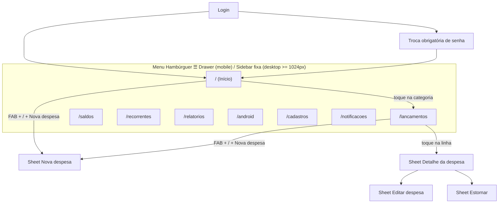

# Proposta de redesign do frontend (PWA): escuro/claro neutro, mobile-first

- Status: **APROVADA E IMPLEMENTADA** (decisões DA-1 a DA-9 validadas pelo usuário em 2026-11-25; ver [ADR 0013](../adr/0013-redesign-frontend-dark-neutral.md)).
- Data: 2026-11-25
- Referência visual: [myfinance-ref.png](referencias/myfinance-ref.png) (app Android "My Finance"). Ela serve de **inspiração para a distribuição dos elementos**, sem compromisso de fidelidade. As cores verde e amarela da referência **não** são usadas.
- Escopo: camada visual e de navegação da PWA (`web/`). **Nenhuma mudança de backend, API ou regra de negócio**.

> Os elementos da referência que não existem no nosso sistema foram **ignorados** e não aparecem nesta proposta: renda/receitas, as abas Despesas|Renda, múltiplas moedas e conversão de câmbio.

---

## 1. Requisitos

### 1.1 Funcionais (reorganizam o que já existe)
| # | Requisito | Origem no código |
|---|---|---|
| RF1 | Tela inicial (`/`) com o total do período em destaque, um donut SVG interativo por categoria com o total no centro, a lista de categorias com ícone circular colorido, barra/percentual e valor (clicar filtra os lançamentos daquela categoria) e cartões de pendências/resumo | KPIs (`App.tsx`), `ReportSummary.by_category` (`ReportsSection`) |
| RF2 | Seletor de período em abas (`Dia`, `Semana`, `Mês`, `Ano`, `Período`, `Tudo`) com navegação `‹ intervalo ›` e mês corrente como padrão (**DA-6 = A**, **DA-8 = A**) | Os filtros `from`/`to` existentes |
| RF3 | Lista de lançamentos (`/lancamentos`) agrupada por dia: ícone circular da categoria, descrição, metadados/badges (parcela `2/10`, recorrente, quem pagou, estorno) e valor à direita, com o total do período no topo, busca textual, ordenação e filtro por categoria | Lista de `ExpensesSection` |
| RF4 | Botão flutuante (FAB) `+` no celular e botão `+ Nova despesa` no cabeçalho desktop (**DA-1 = C**) | Formulário de `ExpensesSection` |
| RF5 | Sheet/Modal de despesa com o valor grande no topo, grade de categorias em ícones circulares, data, descrição e observação, meio de pagamento e seção expansível/organizada para opções avançadas (parcelas `1x..48x`, "pago por" e divisão Igual/Exato/%/Cotas) | Formulário de `ExpensesSection` |
| RF6 | Sheet/Modal de detalhe da despesa com divisões e as ações editar, estornar (parcial/total), compartilhar com a casa, excluir parcela e excluir o parcelamento inteiro | Ações por linha em `ExpensesSection` |
| RF7 | Seletor compacto de ambiente Coletivo/Individual sempre visível na barra superior + controles de privacidade (`👁` ocultar valores, **DA-4 = A**) e tema (`🌙/☀️` escuro/claro neutro, **DA-2 = C**) | `sidebar-ws-box` + novos controles na TopBar |
| RF8 | Navegação por rotas declarativas `react-router` v7 (**DA-5 = C**) com menu hambúrguer `☰` (drawer) no celular e sidebar fixa no desktop (`>= 1024px`) (**DA-1 = C**): Início (`/`), Lançamentos (`/lancamentos`), Saldos (`/saldos`), Recorrentes (`/recorrentes`), Relatórios (`/relatorios`), Captura Android (`/android`), Cadastros (`/cadastros`), Notificações (`/notificacoes`) | As 7 seções existentes + tela Início dedicada |
| RF9 | Login e troca obrigatória de senha no novo design system | `LoginScreen`, `ChangePasswordScreen` |

### 1.2 Não funcionais
- **Mobile-first** (360 px como alvo principal e 320 px como mínimo) e totalmente funcional no desktop (`>= 1024px`).
- **WCAG 2.2 AA**: texto normal com contraste ≥ 4,5:1 (≥ 3:1 para texto grande), bordas de componentes e gráficos com ≥ 3:1 tanto no tema escuro padrão quanto no tema claro (`[data-theme="light"]`), foco visível, navegação completa por teclado, alvos de toque ≥ 44×44 px, `prefers-reduced-motion`.
- **Roteamento e testes aprovados**: `react-router` v7 para rotas SPA (**DA-5 = C**) e `vitest` como devDependency para testes unitários de datas, formatação monetária e categorias/donut (**DA-9 = A**). Ícones e donut continuam em SVG inline puro e modais usam `<dialog>` / sheet acessível.
- Dinheiro continua em **centavos inteiros**: a exibição usa `formatCentsBRL` / `formatMoneyDisplay` e a entrada usa `parseBRLToCents`, sem float.
- Privacidade: nenhum valor financeiro em logs, `console`, títulos de notificação do SO ou `localStorage` (no `localStorage` são salvos apenas `"dark" | "light"` em `ff_theme` e `"1" | "0"` em `ff_hide_values`).

---

## 2. Mapeamento tela a tela

### 2.1 Referência -> nossa tela
| Tela da referência | Nossa tela / componente | Aproveitamos | Ignoramos |
|---|---|---|---|
| 1. Início (saldo + donut) | **Início (`/`)** | Valor grande no topo, abas de período com `‹ intervalo ›`, donut SVG com total no centro, lista de categorias com ícone/%/valor, FAB `+` | "Saldo" (no nosso caso é o **total gasto no período**) e as abas Despesas/Renda |
| 2. Criar categoria | **Cadastros (`/cadastros`)** | Campo nome com prévia instantânea do ícone circular e cor atribuída automaticamente no frontend (**DA-3 = A**) | Toggle Despesas/Renda |
| 3. Operações | **Lançamentos (`/lancamentos`)** | Mesmas abas de período, intervalo de datas, linha "Total", lista agrupada por dia com ícone circular, descrição, metadados/badges e valor | Abas Despesas/Renda |
| 4. Adicionar transação | **Sheet Nova / Editar Despesa** | Valor grande no topo, grade de categorias circulares, data, descrição/observação e botão principal no rodapé | Moedas, câmbio e abas Despesas/Renda |

### 2.2 Seções atuais -> estrutura de rotas (`react-router` v7, DA-5 = C)
| Rota | Tela | Conteúdo |
|---|---|---|
| `/` | **Início** | Card principal com "Total gasto no período", seletor de período, gráfico Donut SVG interativo com total no centro, lista de categorias com barra/percentual e valor (clique filtra `/lancamentos?cat=<id>`), cards de resumo rápido / pendências (posição na casa, reembolsos pendentes, recorrentes ativas, fila Android `needs_review`) e últimos lançamentos |
| `/lancamentos` | **Lançamentos** | Seletor de período, busca, ordenação e filtro por categoria; lista agrupada por dia; clique na linha abre Sheet de detalhes com divisões, estorno, compartilhamento individual->coletivo, edição e exclusão (parcela ou parcelamento inteiro) |
| `/saldos` | **Saldos e Reembolsos** | Quem deve para quem, posição líquida por membro, registro de reembolso e histórico com confirmação/recusa |
| `/recorrentes` | **Recorrentes e Assinaturas** | Geração sob demanda de vencidas, cadastro e lista com pausar/reativar/excluir |
| `/relatorios` | **Relatórios (CSV / PDF)** | Resumo bruto/estornado/líquido, download nativo CSV e PDF, tabelas por categoria, meio de pagamento e desembolso vs consumo por familiar |
| `/android` | **Captura Android e Fila** | Pareamento de celular (token SHA-256 exibido uma única vez), revogação e fila privada de revisão (`parsed` e `needs_review`) com aprovação/descarte |
| `/cadastros` | **Cadastros** | Categorias com ícone/cor automáticos, meios de pagamento/cartões (com dias de fechamento e vencimento) e membros ativos da residência |
| `/notificacoes` | **Notificações** | Caixa de entrada privada por destinatário (RLS), marcar lida/todas lidas e ativação de alerta discreto do navegador |

### 2.3 Navegação (DA-1 = C e DA-5 = C)

- **Mobile (< 1024 px, DA-1 = C)**: sem bottom nav; mantém o botão de menu hambúrguer `☰` na barra superior que abre o drawer lateral responsivo com todas as rotas (`NavLink`), além do botão flutuante FAB `+` no canto inferior direito para abrir rapidamente o Sheet "Nova despesa".
- **Desktop (≥ 1024 px, DA-1 = C)**: sidebar fixa à esquerda (`264px`) sempre visível e botão `+ Nova despesa` na barra superior.
- **Barra superior (`TopBar`)**: botão `☰` (no mobile), título da rota ativa, seletor compacto de Ambiente (`Coletivo` vs `Individual 🔒`), botão `👁` (ocultar valores, **DA-4 = A**), botão `🌙/☀️` (alternar tema escuro/claro, **DA-2 = C**), atalho de Notificações `🔔` com badge de não lidas e botão `+ Nova despesa`.

---

## 3. Design tokens

### 3.1 Cores: tema escuro neutro padrão (`:root`, `[data-theme="dark"]`) — base zinco
Contrastes calculados pela fórmula de luminância relativa da WCAG 2.x.

**Superfícies (elevação por luminosidade)**
| Token | Hex | Uso |
|---|---|---|
| `--bg` | `#0E0E10` | Fundo do app |
| `--surface-1` | `#18181B` | Cartões, listas, sidebar, inputs |
| `--surface-2` | `#232326` | Sheets, menus, item selecionado, hover de linha |
| `--surface-3` | `#2E2E32` | Hover/pressed sobre `surface-2`, trilho do donut |
| `--border` | `#3A3A3F` | Divisores decorativos |
| `--border-strong` | `#76767E` | Borda de input, checkbox, chip não selecionado (≥ 3:1) |

**Texto, ação primária e semânticas (Escuro)**
| Token | Hex | Contraste vs `surface-1` | Uso |
|---|---|---|---|
| `--text` | `#F4F4F5` | 16,12:1 | Texto principal, valores |
| `--text-muted` | `#A1A1AA` | 6,91:1 | Rótulos, metadados, datas |
| `--text-subtle` | `#8B8B94` | 5,25:1 | Placeholders e dicas |
| `--primary` | `#E4E4E7` | 13,96:1 | Botão primário, FAB, aba selecionada |
| `--primary-hover` | `#D4D4D8` | 11,99:1 | Hover/pressed do botão primário |
| `--on-primary` | `#18181B` | 13,96:1 (sobre `--primary`) | Texto/ícone sobre `--primary` |
| `--positive` | `#7BC8A4` | 8,98:1 | "A receber", reembolso confirmado, estorno |
| `--negative` | `#F08A8A` | 7,35:1 | "A pagar", erro, ação destrutiva |
| `--warning` | `#E3B463` | 9,26:1 | Pendente, vencimento próximo, `needs_review` |
| `--info` | `#8AB4F8` | 8,41:1 | Informativo, badge "Coletivo" |

### 3.2 Cores: tema claro neutro (`[data-theme="light"]`, DA-2 = C)
Quando o usuário alterna para o tema claro, `[data-theme="light"]` aplica tokens neutros base zinco claro com contrastes WCAG AA validados:

| Token | Hex | Contraste vs `surface-1` (`#FFFFFF`) | Uso |
|---|---|---|---|
| `--bg` | `#F4F4F5` | – | Fundo geral do app |
| `--surface-1` | `#FFFFFF` | – | Cartões, listas, sidebar, inputs |
| `--surface-2` | `#EFEFF1` | – | Sheets, hover de linha, blocos secundários |
| `--surface-3` | `#E4E4E7` | – | Hover/pressed sobre `surface-2`, trilho do donut |
| `--border` | `#D4D4D8` | – | Divisores decorativos |
| `--border-strong` | `#71717A` | 4,83:1 (≥ 3:1) | Bordas de inputs, chips e controles |
| `--text` | `#18181B` | 17,40:1 (≥ 4,5:1) | Texto principal, valores |
| `--text-muted` | `#52525B` | 7,91:1 (≥ 4,5:1) | Rótulos, metadados, datas |
| `--text-subtle` | `#63636E` | 5,90:1 (≥ 4,5:1) | Placeholders e dicas |
| `--primary` | `#18181B` | 17,40:1 | Botão primário, FAB, aba selecionada |
| `--primary-hover` | `#27272A` | 14,68:1 | Hover/pressed do botão primário |
| `--on-primary` | `#FAFAFA` | 16,65:1 (sobre `--primary`) | Texto/ícone sobre `--primary` |
| `--positive` | `#0F766E` | 5,47:1 (≥ 4,5:1) | "A receber", confirmado |
| `--negative` | `#B91C1C` | 6,47:1 (≥ 4,5:1) | "A pagar", erro, destrutivo |
| `--warning` | `#B45309` | 5,02:1 (≥ 4,5:1) | Pendente, alerta |
| `--info` | `#1D4ED8` | 6,70:1 (≥ 4,5:1) | Informativo, Coletivo |

**Paleta de 8 cores dessaturadas para categorias (`--cat-1` .. `--cat-8`, DA-3 = A)**:
- No tema escuro: `#8AB4F8`, `#F2A37B`, `#7BC8A4`, `#E3B463`, `#C69CF2`, `#F08A8A`, `#6CC4CF`, `#B5B5BD`.
- No tema claro: `#2563EB`, `#C2410C`, `#0D9488`, `#B45309`, `#7C3AED`, `#DC2626`, `#0891B2`, `#52525B`.

### 3.3 Tipografia, Espaçamento, Raios e Movimento
- **Fonte (DA-7 = A)**: `system-ui, -apple-system, 'Segoe UI', Roboto, sans-serif`, com `font-variant-numeric: tabular-nums` em todos os valores monetários, contadores e percentuais.
- **Alvos de toque**: mínimo `44×44 px` (`2.75rem`) em botões, links de menu, abas de período e itens da grade de categorias.
- **Movimento**: transições suaves de `150ms–220ms`, desativadas integralmente sob `@media (prefers-reduced-motion: reduce)`.

---

## 4. Decisões aprovadas pelo usuário (2026-11-25)

| ID | Decisão | Escolha Aprovada |
|---|---|---|
| **DA-1** | Composição da navegação mobile | **(C) Aprovado**: Manter o menu hambúrguer (`☰`) no celular (drawer lateral responsivo no mobile e sidebar fixa no desktop `>= 1024px`, sem bottom nav, com botão FAB `+` flutuante no mobile e `+ Nova despesa` no cabeçalho desktop) |
| **DA-2** | Tema claro / escuro | **(C) Aprovado**: Alternância manual claro/escuro (escuro neutro como padrão e tema claro neutro `[data-theme="light"]` com contrastes WCAG AA; salvar apenas `"dark" \| "light"` em `localStorage`) |
| **DA-3** | Ícone e cor das categorias | **(A) Aprovado**: Definidos no frontend (mapeamento por nome para as 8 categorias padrão + categorias comuns, fallback com inicial e paleta determinística de 8 cores dessaturadas por categoria) |
| **DA-4** | Modo "ocultar valores" (botão `👁`) | **(A) Aprovado**: Botão de olho no topo, desligado por padrão, salvo apenas como `"1" \| "0"` no `localStorage` (`ff_hide_values`), mascarando todos os valores como `R$ ••••` |
| **DA-5** | Navegação e rotas | **(C) Aprovado**: Usar `react-router` v7 com rotas declarativas (`BrowserRouter`, `Routes`, `Route`, `NavLink`, `useNavigate`, `useLocation`, `useSearchParams`), compatível com `web/nginx.conf` e o fallback de SPA em `internal/app/app.go` |
| **DA-6** | Período padrão ao abrir o app | **(A) Aprovado**: Mês corrente como padrão, com abas `Dia`, `Semana`, `Mês`, `Ano`, `Período`, `Tudo` e navegação `‹ intervalo ›` |
| **DA-7** | Fonte | **(A) Aprovado**: Pilha de fontes do sistema + `tabular-nums` |
| **DA-8** | Início da semana na aba "Semana" | **(A) Aprovado**: Segunda-feira (ISO-8601) |
| **DA-9** | Testes automatizados de frontend | **(A) Aprovado**: `vitest` configurado em `web/package.json` (`"test": "vitest run"`) com suíte de testes unitários para `period.ts`, `format.ts` e `categoryVisuals.ts` |
