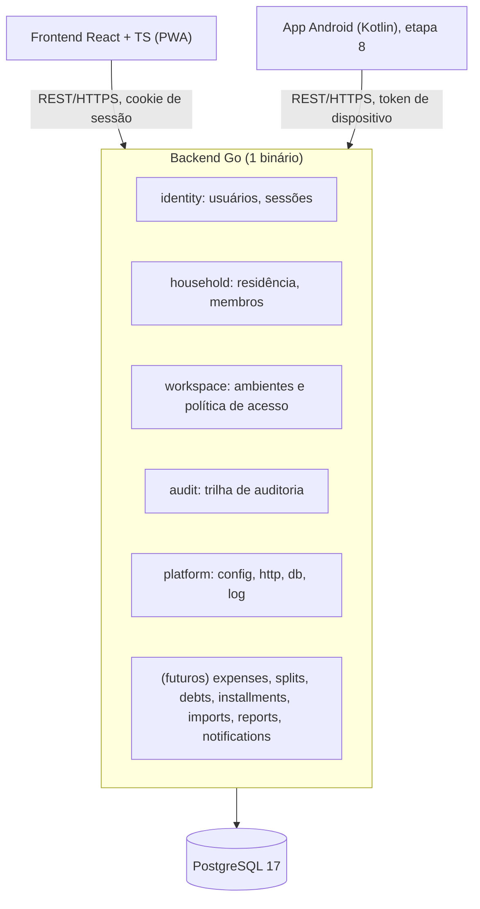
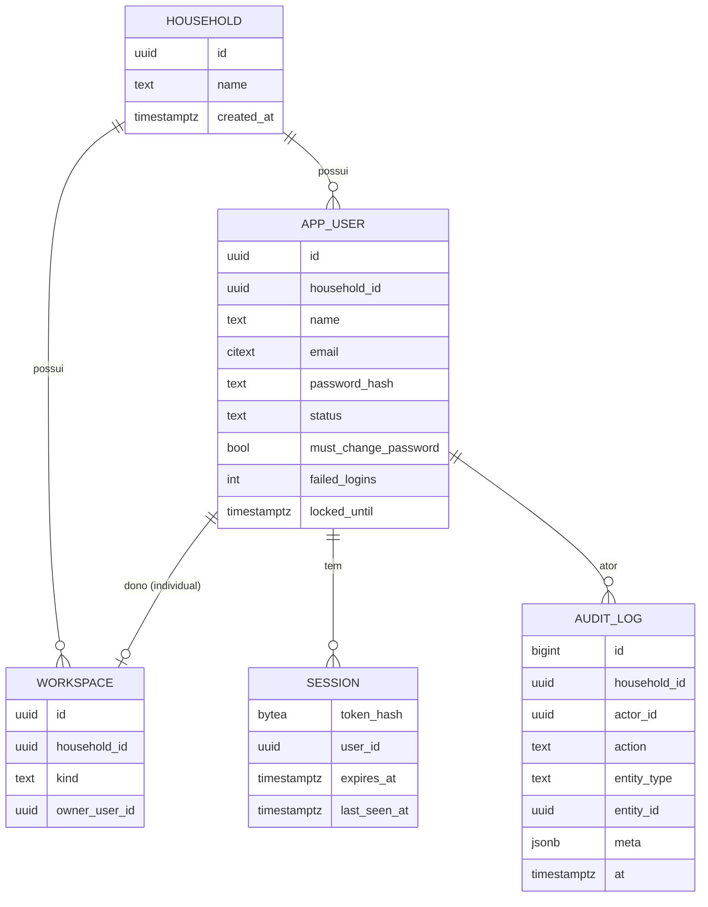

# Finanças Família: arquitetura geral e plano da Etapa 1

> [!IMPORTANT]
> Ainda não escrevi nenhum código. Seguindo a seção 7 do briefing, este documento traz a análise da **Etapa 1** (estrutura, autenticação, usuários, ambientes e banco de dados). As decisões marcadas com ❓ precisam da sua validação antes de eu começar.

## 0. Ambiente local verificado (WSL)

| Ferramenta | Situação |
|---|---|
| Docker Engine 29.1.3 | ✅ daemon rodando |
| Docker Compose (plugin) | ❌ ausente: só há `buildx` e `trust` |
| Go | ❌ ausente |
| Node 24.14.1 / npm | ✅ |
| Git | ✅ |
| Java 25 (Temurin) | ✅ (o Android fica para uma etapa futura) |
| psql | ❌ ausente; dá para usar o cliente de dentro do container |

---

## 1. Roadmap incremental

```mermaid
flowchart LR
  E1["E1: Estrutura, auth, usuários, ambientes, BD"] --> E2["E2: Despesas, categorias, meios de pagamento, compartilhamento"]
  E2 --> E3["E3: Divisões e reembolsos/pagamentos"]
  E3 --> E4["E4: Parcelamentos e estornos"]
  E4 --> E5["E5: Recorrentes"]
  E5 --> E6["E6: Notificações internas e push PWA"]
  E6 --> E7["E7: Relatórios e exportação CSV/PDF"]
  E7 --> E8["E8: App Android de captura e importação"]
  E8 --> E9["E9: Hospedagem, backup, observabilidade de produção"]
```



Cada etapa começa com um documento como este (requisitos, regras, impactos, riscos, aceite, estrutura) e só avança depois da sua validação.

---

## 2. Arquitetura geral (monólito modular)



**Organização interna de cada módulo** (Clean Architecture aplicada sem exagero):

```
internal/<modulo>/
  domain.go        # entidades, regras e erros de domínio (sem dependência de infra)
  service.go       # casos de uso; depende de interfaces (ports)
  repository.go    # interface do repositório
  postgres.go      # implementação com pgx + sqlc
  http.go          # handlers REST + DTOs
  *_test.go
```

Regra de dependência: `http → service → domain`; `postgres` implementa interfaces de `service`. Um módulo só fala com outro pelo `service` público dele, nunca acessando as tabelas do outro diretamente.

### Estrutura do repositório (proposta)

```
financas-familia/
├── backend/
│   ├── cmd/api/            # servidor HTTP
│   ├── cmd/admin/          # CLI: bootstrap da residência, criação de usuários
│   ├── internal/platform/  # config, logger (slog), db, middlewares, health
│   ├── internal/identity/
│   ├── internal/household/
│   ├── internal/workspace/
│   ├── internal/audit/
│   ├── migrations/         # SQL versionado (goose)
│   ├── queries/            # SQL do sqlc
│   └── Dockerfile
├── frontend/               # Vite + React + TS + vite-plugin-pwa
├── android/                # etapa 8
├── deploy/
│   ├── docker-compose.yml
│   └── .env.example
├── docs/
│   ├── adr/                # Architecture Decision Records
│   ├── arquitetura.md
│   └── instalacao.md
├── .github/workflows/ci.yml
└── Makefile
```

### Bibliotecas propostas (todas gratuitas e open source)

| Necessidade | Escolha | Motivo |
|---|---|---|
| Roteamento HTTP | `net/http` (ServeMux do Go ≥1.22) | já aceita métodos e parâmetros de rota, sem dependência extra |
| Driver PostgreSQL | `pgx/v5` | padrão de fato, com pool |
| Acesso a dados | `sqlc` | SQL explícito e tipado, sempre parametrizado (contra SQLi) e sem ORM "mágico" |
| Migrations | `goose` | arquivos SQL simples; roda via CLI ou embutido |
| Hash de senha | `argon2id` (`golang.org/x/crypto`) | recomendação atual do OWASP |
| Logs | `log/slog` (JSON) | stdlib, logs estruturados |
| Testes de integração | `testcontainers-go` (Postgres real) | testa RLS e constraints de verdade |
| Frontend | Vite, React, TS, React Router, TanStack Query, `vite-plugin-pwa` | stack simples e bem documentada |

---

## 3. Etapa 1: requisitos envolvidos

- **RF01** Gestão de usuários: credenciais individuais, sem conta compartilhada, acesso restrito a membros autorizados.
- **RF02** Ambientes: estrutura dos ambientes coletivo e individual. As despesas em si ficam para a E2.
- **RNF01** Segurança: auth, hash, autorização no backend, rate limit, sessões, segredos, logs sem dados sensíveis.
- **RNF02** LGPD: mínimo de dados e auditoria.
- **RNF06** Manutenibilidade: estrutura modular, migrations, testes, ADRs.
- **RNF07** Observabilidade (parte): logs estruturados e health checks.
- **Cenários de aceite 1, 2 (base) e 15 (parcial).**

## 4. Regras de negócio da Etapa 1

1. Existe **uma residência** (household) com **até 4 membros ativos**. O limite fica configurável, sem número fixo no código.
2. **Não há cadastro público.** Usuários só são criados por um fluxo autorizado (ver ❓D3).
3. Cada usuário tem **exatamente um ambiente individual**, criado junto com ele na mesma transação.
4. A residência tem **exatamente um ambiente coletivo**.
5. **Política de acesso central** (`workspace.Policy`):
   - ambiente coletivo: qualquer membro ativo da residência pode acessar;
   - ambiente individual: só o dono.
   - Todo registro financeiro futuro terá `workspace_id`, e toda consulta passa por essa política. É a base dos cenários 2 e 4.
6. Para um recurso inexistente **ou** de outro usuário, a API responde **404**. Assim ela não revela se o recurso existe.
7. E-mail é único e comparado sem diferenciar maiúsculas/minúsculas.
8. Ações relevantes (login ok/falho, logout, troca de senha, criação de usuário) vão para a **auditoria**, sem senha, token ou dado financeiro.

## 5. Modelo de dados inicial



- `workspace.kind ∈ {household, personal}`, com `CHECK`: `personal` exige `owner_user_id` e `household` exige que ele seja nulo. Índices únicos parciais garantem 1 coletivo por residência e 1 individual por usuário.
- **Dinheiro (já decidido para as próximas etapas):** `BIGINT` em **centavos** e `int64` no Go, só BRL. Assim não há erro de ponto flutuante, e o rateio de centavos fica determinístico. A alternativa é `NUMERIC(14,2)`; registro a escolha em ADR.
- Sessão: no banco fica só o **hash SHA-256** do token. O token em si fica apenas no cookie.

### Defesa em profundidade: RLS no PostgreSQL

- A API conecta com um papel `app_rw` que **não é dono** das tabelas (as migrations rodam com outro papel, `app_owner`) e usa `FORCE ROW LEVEL SECURITY`.
- Em cada transação autenticada, o backend executa `SET LOCAL app.user_id = '<uuid>'`. As políticas RLS filtram `workspace` e as tabelas futuras por esse valor.
- Isso funciona tanto em **Postgres puro** quanto no **Supabase** (que também é Postgres), então não prende a solução ao provedor. Se a autorização do Go falhar por algum bug, o banco ainda bloqueia.

## 6. API REST da Etapa 1

| Método | Rota | Descrição |
|---|---|---|
| POST | `/api/v1/auth/login` | e-mail e senha, emite cookie de sessão |
| POST | `/api/v1/auth/logout` | revoga a sessão |
| GET | `/api/v1/auth/me` | usuário atual |
| POST | `/api/v1/auth/password` | troca de senha (revoga as outras sessões) |
| GET | `/api/v1/household` | residência e membros (nome, sem e-mail dos outros) |
| GET | `/api/v1/workspaces` | ambientes acessíveis: o meu individual e o coletivo |
| GET | `/api/v1/workspaces/{id}` | detalhe (404 se não tiver acesso) |
| GET | `/healthz` / `/readyz` | liveness / readiness (checa o BD) |

Frontend da E1: telas de login, troca de senha obrigatória, e uma home com seletor de ambiente "Família / Meu espaço" (ainda vazio). Inclui o manifest PWA básico.

## 7. Riscos de segurança e mitigação

| Risco (OWASP) | Mitigação |
|---|---|
| Quebra de controle de acesso / IDOR (A01) | política central + RLS + testes automatizados de acesso cruzado + 404 |
| Força bruta / credential stuffing (A07) | rate limit por IP e por e-mail, bloqueio temporário progressivo, mensagem de erro genérica, argon2id |
| Sequestro de sessão | cookie `HttpOnly; Secure; SameSite=Lax`, token aleatório de 256 bits, expiração absoluta e por inatividade, rotação no login, revogação |
| CSRF | SameSite + checagem de `Origin` e header customizado em métodos de escrita |
| XSS (A03) | React escapa por padrão; CSP restritiva; proibido `dangerouslySetInnerHTML` |
| SQLi (A03) | só queries parametrizadas (sqlc); `app_rw` com privilégio mínimo |
| Segredos expostos (A02/A05) | `.env` fora do Git, `.env.example` sem valores reais, nada sensível no frontend, `gitleaks` no CI |
| Vazamento em logs | logger com lista de campos permitidos; sem corpo de request, e-mail ou valores |
| Dependências vulneráveis (A06) | `govulncheck` e `npm audit` no CI, Dependabot |
| HTTPS | local: HTTP no localhost; em produção, TLS no proxy (Caddy ou do provedor). Definido na E9 |

## 8. Critérios de aceite da Etapa 1

1. `docker compose up` sobe Postgres, API e frontend; `/readyz` responde 200.
2. Migrations sobem e descem sem erro.
3. Os 4 usuários criados pelo fluxo autorizado fazem login com as próprias credenciais; senha errada dá erro genérico, e após N tentativas há bloqueio temporário.
4. `GET /workspaces` retorna só o ambiente individual do próprio usuário e o coletivo.
5. **Teste automatizado:** o usuário A, ao chamar `/workspaces/{id-individual-de-B}`, recebe 404; uma query direta no BD com `app.user_id = A` não enxerga a linha de B (RLS).
6. Sem sessão, rotas protegidas retornam 401.
7. CI no GitHub Actions roda lint, testes (com Postgres), `govulncheck` e o build do frontend.
8. `docs/instalacao.md` e os ADRs iniciais estão escritos.

---

## 9. Decisões que preciso que você valide ❓

### D1: Autenticação: Supabase Auth ou auth própria no Go?

| | **A) Auth própria no Go** (recomendada) | **B) Supabase Auth** |
|---|---|---|
| Independência do provedor | total | Go valida JWT do Supabase; trocar de provedor exige migrar os usuários |
| Dev local com Docker | 1 container de Postgres | Supabase CLI sobe cerca de 10 containers (mais pesado, ~2–3 GB RAM) |
| Esforço / risco | mais código de segurança sob minha responsabilidade (mitigado com argon2id, testes e padrões OWASP) | menos código de auth |
| App Android | token de dispositivo revogável, simples | precisa do SDK ou fluxo OAuth do Supabase |
| Aprendizado | alto (sessões, hashing, rate limit) | médio |

Mesmo com A, o **Supabase continua elegível como Postgres gerenciado** na hospedagem (com RLS). Dados do plano gratuito consultados hoje (reconfirmar antes do deploy): 500 MB de banco, **pausa após 7 dias sem atividade no banco**, **sem backup automático**, 2 projetos ativos, 5 GB/mês de egress.

### D2: Sessão
Recomendo **sessão opaca em cookie HttpOnly guardada no BD** para a PWA (revogação imediata, sem JWT exposto ao JS) e **token de dispositivo separado** para o app Android (E8).

### D3: Como os 4 usuários entram
- **(a) recomendado:** um CLI `admin bootstrap` cria a residência e os usuários com **senha temporária** e troca obrigatória no primeiro login;
- (b) convite com link de uso único (exige envio de e-mail ou que o link seja repassado manualmente);
- (c) lista de e-mails autorizados e cadastro próprio.

### D4: Ambiente de desenvolvimento
Faltam o Go e o Docker Compose. Opções:
- **(a) recomendado:** instalar os dois **no seu usuário, sem sudo**: Go oficial em `~/.local/go` e plugin compose em `~/.docker/cli-plugins`;
- (b) rodar Go e Compose só dentro de containers (nada instalado no host, mas a experiência de desenvolvimento piora);
- (c) você instala via `apt` com sudo.

### D5: Local e versionamento
- Pasta proposta: `/home/gamer/projetos/financas-familia` (repositório Git local; o repo **privado** no GitHub você cria quando quiser).

### D6: Registro de atividades
O `AGENTS.md` manda registrar tudo em `contexto_cybersec.txt`, que é do estudo de cybersec. Sugiro criar `projetos/financas-familia/docs/CONTEXTO.md` para este projeto e deixar no arquivo de cybersec apenas uma linha de referência. Posso?

---

## 10. Pendências que ficam para etapas futuras (não vou inventar)

| Pendência | Quando decidir |
|---|---|
| Bancos suportados na captura | antes da E8. Vou pedir exemplos **reais e anonimizados** de notificações de cada banco |
| Dispositivos Android (versões) | antes da E8 |
| Fechamento e vencimento de cada cartão | E4. Proposta: campos opcionais no cartão; sem eles, a data fica marcada como *estimada* |
| Confirmação de reembolso (credor x devedor) | E3. Vou apresentar alternativas (só o credor confirma / devedor informa e credor confirma) |
| Notificações com formato incompleto ou alterado | E8. Proposta: parser versionado por banco, sem "chute"; qualquer falha vai para a fila de revisão |
| Hospedagem gratuita do backend | E9, com comparação verificada (limites, suspensão, backup, risco de custo) |
