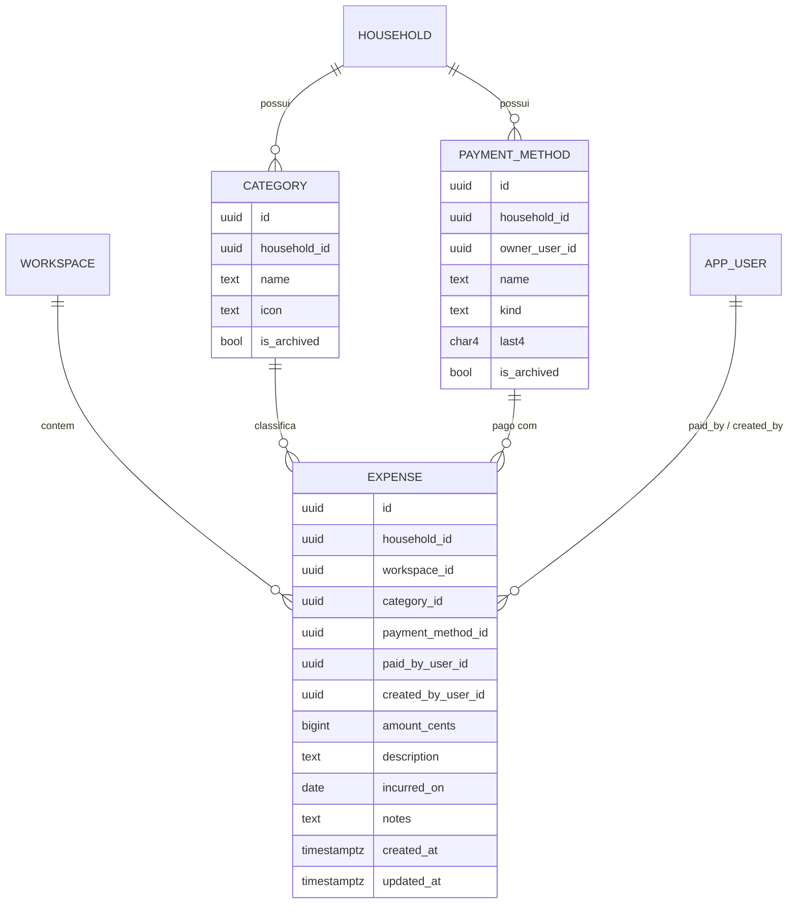

# Plano da Etapa 2: Despesas, Categorias, Meios de Pagamento e Compartilhamento

> [!IMPORTANT]
> Seguindo as regras do projeto, este documento apresenta os requisitos, regras de negócio, modelo de dados, impactos arquiteturais, riscos de segurança e critérios de aceite da **Etapa 2** para sua validação antes de qualquer implementação.

## 1. Requisitos cobertos na Etapa 2

- **RF02 (completo)**: lançamento e consulta de despesas no ambiente individual (privado) ou coletivo (casa), mais a ação de compartilhar uma despesa individual com a casa.
- **RF03**: cadastro e listagem de categorias de despesas (padrão + personalizadas da família).
- **RF04**: cadastro de meios de pagamento (PIX, débito, dinheiro, transferência, cartão de crédito com 4 últimos dígitos opcionais — **nunca** número completo, CVV ou senha).
- **RNF01 / RNF02**: valores em centavos (`BIGINT` / `int64`), validação de acesso via `workspace.CanAccess` + RLS no PostgreSQL, zero dados financeiros em logs.

> Observação: divisões entre membros e reembolsos ficam na **Etapa 3**; parcelamentos e estornos na **Etapa 4**; recorrentes na **Etapa 5**.

---

## 2. Regras de negócio da Etapa 2

1. **Todo lançamento pertence a exatamente um `workspace_id`** (individual do criador ou coletivo da residência).
2. **Privacidade estrita**:
   - Despesa em ambiente `personal`: só o dono pode ver, editar, excluir ou compartilhar. Qualquer outro membro recebe **404**.
   - Despesa em ambiente `household`: todos os membros ativos da residência podem ver; quem criou (`created_by`) ou pagou (`paid_by`) pode editar/excluir (❓ ver Decisão E2-D1 abaixo).
3. **Valores monetários**: sempre inteiros positivos em **centavos** (`amount_cents > 0`), somente BRL (ADR 0002).
4. **Categorias**:
   - Vinculadas à residência (`household_id`), visíveis a todos os membros da casa para manter padronização nos relatórios futuros.
   - Conjunto inicial sugerido no seed/bootstrap: Alimentação, Moradia, Contas (Água/Luz/Internet), Transporte, Saúde, Lazer, Educação, Outros.
   - Categorias em uso não são apagadas fisicamente (`is_archived = true`).
5. **Meios de pagamento**:
   - Cada meio de pagamento pode ser pessoal (`owner_user_id = usuário`) ou compartilhado da casa (`owner_user_id IS NULL`).
   - Tipos suportados (`kind`): `pix`, `debit`, `credit_card`, `cash`, `transfer`, `other`.
   - Para cartão (`credit_card`), permite opcionalmente `last4` (exatamente 4 dígitos numéricos). Qualquer tentativa de enviar mais de 4 dígitos ou padrão de PAN completo é rejeitada pela validação.
6. **Compartilhar despesa individual com a casa**:
   - Uma despesa originalmente criada no ambiente individual pode ser movida para o ambiente coletivo da residência pelo seu dono (`POST /api/v1/expenses/{id}/share-with-household`), registrando o evento na trilha de auditoria (sem valor monetário no log).

---

## 3. Modelo de dados proposto (`00002_expenses.sql`)



### Políticas de RLS no PostgreSQL (`FORCE ROW LEVEL SECURITY`)
- `category`: `household_id = app_current_household_id()`.
- `payment_method`: `household_id = app_current_household_id() AND (owner_user_id IS NULL OR owner_user_id = app_current_user_id())`.
- `expense`: `household_id = app_current_household_id()` **E** `workspace_id` acessível segundo a mesma regra de `workspace` (coletivo da casa ou individual do `app_current_user_id()`).

---

## 4. Impactos arquiteturais e estrutura proposta

Novo módulo `backend/internal/expense/` (ou dividido em `catalog/` para categorias/meios de pagamento e `expense/` para despesas):
```
backend/
├── migrations/00002_expenses.sql
├── queries/expenses.sql
└── internal/expense/
    ├── domain.go
    ├── service.go
    ├── http.go
    ├── expensedb/          # gerado pelo sqlc
    └── expense_test.go
```

### Rotas REST da Etapa 2
- `GET /api/v1/categories` | `POST /api/v1/categories` | `PATCH /api/v1/categories/{id}`
- `GET /api/v1/payment-methods` | `POST /api/v1/payment-methods` | `PATCH /api/v1/payment-methods/{id}`
- `GET /api/v1/workspaces/{wsId}/expenses?from=AAAA-MM-DD&to=AAAA-MM-DD&category_id=...` (com resumo do total em centavos no período)
- `POST /api/v1/workspaces/{wsId}/expenses`
- `GET /api/v1/expenses/{id}` | `PATCH /api/v1/expenses/{id}` | `DELETE /api/v1/expenses/{id}`
- `POST /api/v1/expenses/{id}/share-with-household`

---

## 5. Riscos de segurança e mitigação

| Risco | Mitigação |
|---|---|
| Acesso indevido a despesa individual de outro membro (IDOR) | Checagem em Go (`workspace.CanAccess`) + RLS `FORCE` na tabela `expense` + retorno 404 |
| Uso de `payment_method` privado de outro membro numa despesa | FK/checagem no serviço e RLS em `payment_method` |
| Armazenamento acidental de PAN de cartão na descrição ou `last4` | `CHECK (last4 ~ '^[0-9]{4}$')` no banco + rejeição de sequências de 13–19 dígitos na descrição/notas |
| Vazamento de valores em logs | Logger HTTP continua registrando apenas método, rota padrão e status; auditoria registra apenas IDs e ação |

---

## 6. Critérios de aceite da Etapa 2

1. Membro cria categoria e meio de pagamento (pessoal e coletivo); `last4` inválido é rejeitado com 422.
2. Membro A cria despesa no seu ambiente individual; Membro B não a vê em listagens e recebe **404** ao buscar por ID (tanto via API quanto via query direta com RLS).
3. Membro A compartilha essa despesa individual com a casa; ela passa a aparecer no ambiente coletivo para todos os membros.
4. Listagem de despesas filtra por período (`from`/`to`) e categoria e devolve a soma exata em centavos (`total_cents`).
5. Frontend PWA permite alternar entre "Espaço da Família" e "Meu Espaço Individual", cadastrar/listar despesas, categorias e meios de pagamento, e compartilhar uma despesa individual com a casa.

---

## 7. Decisões da Etapa 2 para sua validação ❓

- **E2-D1 (Permissão de edição/exclusão no ambiente coletivo)**: No ambiente coletivo da família, quem pode editar ou excluir uma despesa já lançada?
  - **(a) Recomendado**: qualquer membro ativo da família (com registro na trilha de auditoria de quem editou/excluiu), pois facilita correções no dia a dia de 4 familiares;
  - **(b) Restrito**: apenas quem criou (`created_by`) ou quem pagou (`paid_by`).
- **E2-D2 (Categorias iniciais)**: Posso já criar automaticamente no bootstrap/migration as 8 categorias padrão (Alimentação, Moradia, Contas, Transporte, Saúde, Lazer, Educação, Outros) para a residência?
