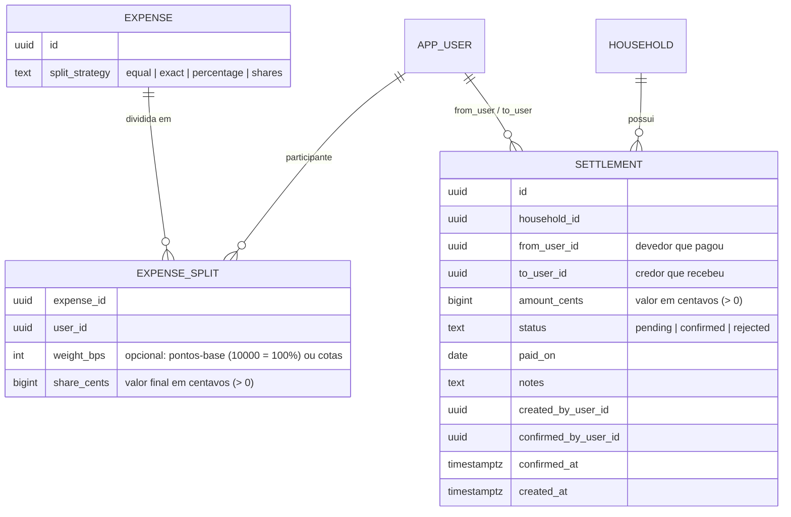

# Plano da Etapa 3: Divisões de Despesas e Reembolsos / Acerto de Contas

> [!IMPORTANT]
> Seguindo as regras do projeto, este documento apresenta os requisitos, regras de negócio, impactos arquiteturais, riscos de segurança, critérios de aceite e decisões em aberto da **Etapa 3** para sua validação antes da implementação.

## 1. Requisitos cobertos na Etapa 3

- **RF05 (Divisão de despesas coletivas)**:
  - Divisão **igualitária** (entre todos os participantes selecionados), por **valor fixo em centavos** por pessoa, ou por **porcentagem / cotas** (ex.: 50%/50% ou 2 cotas / 1 cota).
  - A soma das partes individuais em centavos (`sum(share_cents)`) **sempre** deve ser igual ao valor total da despesa (`expense.amount_cents`), sem sobra nem falta de 1 centavo.
- **RF06 (Saldos, dívidas e reembolsos entre familiares)**:
  - Cálculo claro de **quem deve quanto para quem** (saldo bilateral e líquido entre os membros ativos da casa) com base nas despesas coletivas divididas e nos reembolsos confirmados.
  - Registro e histórico de **reembolsos / pagamentos** entre dois membros para abater o saldo devedor.

---

## 2. Regras de negócio da Etapa 3

1. **Escopo das divisões**:
   - Somente despesas no **ambiente coletivo** (`workspace.kind = 'household'`) possuem divisão entre membros.
   - Uma despesa no ambiente individual não gera dívida para outros membros. Quando uma despesa individual é compartilhada com a casa (`share-with-household`), ela recebe por padrão uma divisão igualitária entre todos os membros ativos (que pode ser editada em seguida).
2. **Invariante dos centavos (`sum(share_cents) == expense.amount_cents`)**:
   - Todos os valores são inteiros em **centavos** (`BIGINT` / `int64`, ADR 0002).
   - **Rateio determinístico do resto (centavos que sobram)** em divisões igualitárias ou por porcentagem/peso (ex.: R$ 100,00 = `10000` centavos dividido igualmente por 3 pessoas = `3333` + `3333` + `3333`, sobrando `1` centavo):
     - Cada participante recebe $\lfloor \text{total} \times w_i / \sum w \rfloor$;
     - Os $R$ centavos restantes ($0 \le R < N$) são distribuídos `+1 centavo` para os primeiros $R$ participantes segundo uma ordem determinística (❓ ver Decisão **E3-D1** abaixo).
   - Em divisão por **valor exato (`exact`)**, a API rejeita com `422` se a soma das partes enviadas for diferente de `amount_cents`.
3. **Cálculo de saldo entre dois membros ($A$ e $B$)**:
   - Quando $A$ paga uma despesa coletiva (`paid_by_user_id = A`) e a cota de $B$ nessa despesa é `share_cents`, $B$ passa a dever `+share_cents` a $A$.
   - Quando um reembolso de $B$ para $A$ no valor `settlement.amount_cents` está **confirmado**, a dívida de $B$ com $A$ reduz em `settlement.amount_cents`.
   - O saldo líquido entre $A$ e $B$ é $(\text{dívida de } B \text{ para } A) - (\text{dívida de } A \text{ para } B)$.
4. **Fluxo de confirmação de reembolso**:
   - Conforme a regra do projeto ("Não invente respostas para decisões em aberto: confirmação de reembolso"), apresento as duas alternativas em **E3-D2** abaixo para você escolher.

---

## 3. Modelo de dados proposto (`00003_splits_and_settlements.sql`)

### RLS no PostgreSQL (`FORCE ROW LEVEL SECURITY`)
- `expense_split`: acessível por `app_rw` somente se a `expense` pai for acessível por `app_can_access_workspace(e.workspace_id)`.
- `settlement`: `household_id = app_current_household_id()`.

---

## 4. Impactos arquiteturais e estrutura proposta

- Evolução do módulo `backend/internal/expense/` para gravar e retornar os `splits` na mesma transação da despesa coletiva.
- Novo módulo `backend/internal/settlement/` (ou `debt/`) para:
  - Cálculo de saldos bilaterais e plano de quitação entre membros (`GET /api/v1/balances`);
  - Registro, listagem e confirmação de reembolsos (`GET /api/v1/settlements`, `POST /api/v1/settlements`, `POST /api/v1/settlements/{id}/confirm`, `POST /api/v1/settlements/{id}/reject`).

---

## 5. Riscos de segurança e mitigação

| Risco | Mitigação |
|---|---|
| Soma das cotas diferente do total da despesa (criação/perda de dinheiro) | Validação em Go dentro da transação + teste de propriedade garantindo `sum(share_cents) == amount_cents` |
| Participante de outra residência incluído na divisão | Verificação na transação de que todos os `user_id` da divisão são membros ativos da mesma `household_id` |
| Devedor marcar sozinho uma dívida como quitada sem o credor ter recebido | Mitigado pelo fluxo escolhido em **E3-D2** + trilha de auditoria (`settlement.created`, `settlement.confirmed`, `settlement.rejected`) |
| Vazamento de valores em logs | Auditoria e logs HTTP continuam sem valores monetários |

---

## 6. Critérios de aceite da Etapa 3

1. Despesa coletiva de `10000` centavos (R$ 100,00) dividida igualmente entre 3 membros gera 3 cotas que somam exatamente `10000` centavos (`3334`, `3333`, `3333`) de forma determinística.
2. Divisão por valores exatos cuja soma difere do total da despesa é rejeitada com HTTP 422.
3. `GET /api/v1/balances` calcula exatamente quanto cada membro deve ou tem a receber dos demais com base nas despesas do ambiente coletivo (despesas do ambiente individual nunca entram no cálculo).
4. Registro e confirmação de reembolso abate o saldo devedor entre os dois membros e fica registrado no histórico e na auditoria.
5. Frontend PWA permite escolher a divisão ao lançar/editar uma despesa coletiva e exibe o painel **"Saldos e Reembolsos da Família"**.

---

## 7. Decisões da Etapa 3 para sua validação ❓

| # | Decisão | Opções |
|---|---|---|
| **E3-D1** | **Quem absorve os centavos que sobram** numa divisão igualitária ou por porcentagem (ex.: 1 centavo de resto em R$ 100,00 ÷ 3)? | **(a) Recomendado:** o membro que pagou a despesa (`paid_by`, se estiver entre os participantes) e depois em ordem alfabética/ID dos participantes — é determinístico e auditável. **(b)** Sempre em ordem alfabética dos participantes. **(c)** Rodízio por ID da despesa. |
| **E3-D2** | **Confirmação de reembolso** entre devedor e credor | **(a) Recomendado (duas etapas quando registrado pelo devedor):** o devedor registra "Paguei R$ X para Fulano" (status `pending`) e o credor confirma que recebeu (`confirmed`); se o próprio **credor** registrar "Recebi R$ X de Beltrano", já nasce `confirmed`. **(b) Confirmação imediata unilateral:** qualquer um dos dois (devedor ou credor) registra e o saldo já é abatido na hora, ficando registrado na auditoria quem lançou. |
