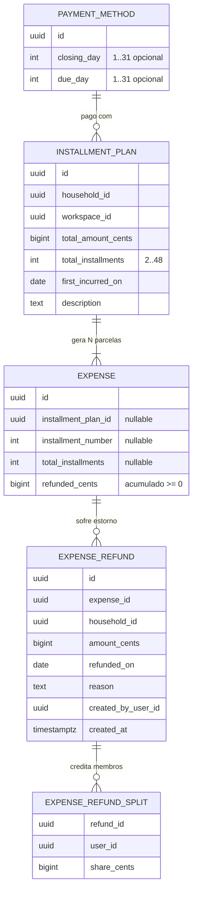

# Plano da Etapa 4: Parcelamentos e Estornos

> [!IMPORTANT]
> Seguindo as regras do projeto, este documento apresenta os requisitos, regras de negócio, modelo de dados, impactos arquiteturais, riscos de segurança, critérios de aceite e decisões em aberto da **Etapa 4** para sua validação antes da implementação.

## 1. Requisitos cobertos na Etapa 4

- **RF07 (Compras parceladas)**:
  - Lançamento de compra parcelada em $N$ parcelas ($2 \le N \le 48$) tanto no ambiente individual quanto no coletivo;
  - Preservação exata do valor total em centavos: a soma das $N$ parcelas (`sum(amount_cents)`) é sempre idêntica ao valor total da compra (`total_amount_cents`), sem perda nem criação de centavos;
  - Identificação clara de cada parcela (`installment_number / total_installments`, ex.: `1/10`, `2/10`...);
  - Suporte opcional a dia de fechamento e dia de vencimento nos cartões de crédito para cálculo da competência/vencimento de cada parcela.
- **RF08 (Estornos totais e parciais)**:
  - Registro de estorno total ou parcial vinculado a uma despesa (individual ou coletiva), reduzindo o gasto líquido do período e — quando coletiva — abatendo proporcionalmente o saldo entre os familiares participantes.

---

## 2. Regras de negócio da Etapa 4

1. **Invariante de centavos no parcelamento**:
   - Dado um valor total da compra $T$ em centavos e $N$ parcelas ($2 \le N \le 48$):
     - Cada parcela recebe $\lfloor T / N \rfloor$ centavos;
     - O resto $R = T \bmod N$ ($0 \le R < N$) é alocado na **1ª parcela** (padrão do mercado financeiro/cartões no Brasil: ex.: R$ 100,00 em 3x → 1ª de R$ 33,34 e 2ª e 3ª de R$ 33,33).
2. **Materialização das parcelas**:
   - Cada parcela é um registro na tabela `expense` vinculado a um `installment_plan_id` comum, com `installment_number` ($1 \dots N$) e `total_installments` ($N$).
   - Por que materializar cada parcela como `expense`?
     - Cada parcela aparece automaticamente no filtro mensal correspondente (`from`/`to`), tem seu próprio `expense_split` em centavos no mês de competência e pode ser consultada, filtrada ou estornada sem cálculos mágicos em tempo de leitura.
3. **Datas das parcelas e fechamento/vencimento do cartão**:
   - Conforme a regra do projeto ("Não invente respostas para decisões em aberto: fechamento/vencimento de cartões"), apresento as opções em **E4-D1** abaixo.
4. **Estornos (Refunds)**:
   - Um estorno nunca apaga a despesa original (preserva a trilha histórica e contábil).
   - Pode ser **total** (igual ao saldo restante da despesa) ou **parcial** ($0 < \text{refund\_cents} \le \text{expense.amount\_cents} - \text{estornos\_anteriores}$).
   - Quando registrado numa despesa **coletiva**, o estorno gera cotas de crédito (`refund_split`) para os mesmos participantes da despesa original (usando a mesma proporção e rateio determinístico de centavos do ADR 0006), abatendo automaticamente a dívida no cálculo de `GET /api/v1/balances`.

---

## 3. Modelo de dados proposto (`00004_installments_and_refunds.sql`)

### RLS no PostgreSQL (`FORCE ROW LEVEL SECURITY`)
- `installment_plan`: `household_id = app_current_household_id() AND app_can_access_workspace(workspace_id)`.
- `expense_refund` e `expense_refund_split`: acessíveis somente se a `expense` pai for acessível por `app_can_access_expense(expense_id)`.

---

## 4. Rotas REST da Etapa 4

- `PATCH /api/v1/payment-methods/{id}` e `POST /api/v1/payment-methods`: passam a aceitar opcionalmente `closing_day` (`1..31`) e `due_day` (`1..31`) para `credit_card`.
- `POST /api/v1/workspaces/{wsId}/expenses`: passa a aceitar `total_installments` (`1..48`, padrão `1`). Quando `> 1`, cria o `installment_plan` e as $N$ parcelas (com seus respectivos `expense_split` se coletivo) numa única transação.
- `DELETE /api/v1/installment-plans/{planId}`: exclui todas as parcelas de um parcelamento de uma só vez.
- `POST /api/v1/expenses/{id}/refunds`: registra um estorno total ou parcial (`amount_cents`, `refunded_on`, `reason`) na despesa.
- `GET /api/v1/expenses/{id}/refunds`: lista os estornos da despesa.

---

## 5. Riscos de segurança e mitigação

| Risco | Mitigação |
|---|---|
| Estorno maior que o valor da despesa (gerando crédito falso) | Lock da linha da despesa (`SELECT ... FOR UPDATE`) na transação e checagem `refunded_cents + amount_cents <= expense.amount_cents` |
| Criação de centavos no parcelamento ou no estorno coletivo | Rateio inteiro determinístico (resto na 1ª parcela; no estorno coletivo, mesma regra do ADR 0006) |
| Acesso cruzado a parcelamento ou estorno individual de outro membro | RLS `FORCE` em `installment_plan`, `expense_refund` e `expense_refund_split` + retorno 404 |

---

## 6. Critérios de aceite da Etapa 4

1. Compra parcelada de `10000` centavos (R$ 100,00) em 3x gera 3 parcelas no banco: `1/3` de `3334` centavos, `2/3` de `3333` centavos e `3/3` de `3333` centavos, em meses consecutivos.
2. No filtro mensal de despesas, cada parcela aparece no seu respectivo mês e `total_cents` desconta eventuais estornos (`amount_cents - refunded_cents`).
3. Estorno parcial ou total numa despesa coletiva reduz automaticamente a dívida dos membros participantes em `GET /api/v1/balances`; tentativa de estornar valor maior que o saldo da despesa retorna HTTP 422.
4. Frontend PWA permite informar o número de parcelas (`1x` a `48x`) ao lançar uma despesa, exibe a etiqueta `Parcela k/N`, permite configurar fechamento/vencimento opcional nos cartões e permite registrar estorno parcial ou total em qualquer despesa.

---

## 7. Decisões da Etapa 4 para sua validação ❓

| # | Decisão | Opções |
|---|---|---|
| **E4-D1** | **Datas das parcelas e fechamento/vencimento do cartão** | **(a) Recomendado:** `closing_day` e `due_day` são campos opcionais (`1..31`) no cartão de crédito. A 1ª parcela fica na data da compra (ou no próximo ciclo se a compra ocorrer no dia do fechamento ou depois) e as parcelas $2 \dots N$ avançam mês a mês mantendo o dia (ajustado para o último dia do mês em meses mais curtos, como fevereiro). **(b)** Sempre somar +1 mês a partir da data da compra informada, sem usar dia de fechamento do cartão. |
| **E4-D2** | **Exclusão de compra parcelada** | **(a) Recomendado:** permitir tanto excluir uma parcela individual quanto excluir o parcelamento inteiro (`DELETE /api/v1/installment-plans/{planId}`). **(b)** Só permitir excluir o parcelamento inteiro de uma vez. |
