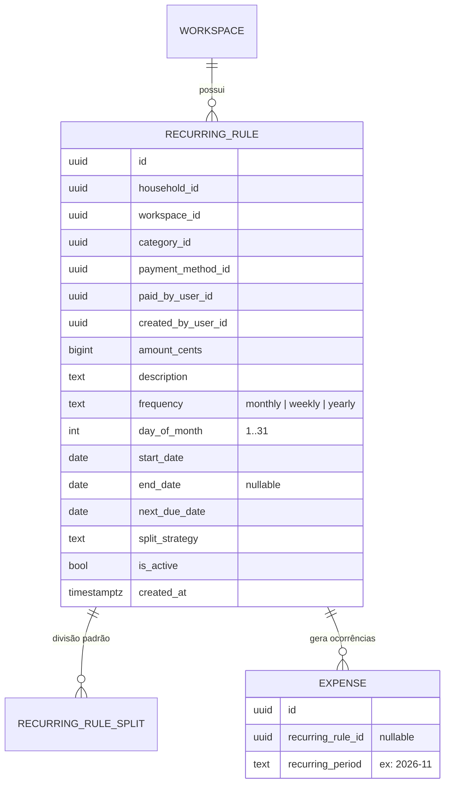

# Plano da Etapa 5: Despesas e Contas Recorrentes

> [!IMPORTANT]
> Seguindo as regras do projeto, este documento apresenta os requisitos, regras de negócio, modelo de dados, impactos arquiteturais, riscos de segurança, critérios de aceite e decisões em aberto da **Etapa 5** para sua validação antes da implementação.

## 1. Requisitos cobertos na Etapa 5

- **RF09 (Contas e despesas recorrentes)**:
  - Cadastro de modelos/regras de despesas recorrentes (ex.: Aluguel, Condomínio, Energia, Água, Internet, Streaming, Academia) tanto no **ambiente coletivo da casa** quanto no **ambiente individual privado** de cada membro;
  - Periodicidade configurável (`monthly` mensal, `weekly` semanal ou `yearly` anual), dia de vencimento/referência, valor padrão em centavos (`amount_cents`), categoria, meio de pagamento opcional e — quando coletiva — estratégia de divisão padrão entre familiares;
  - Geração idempotente dos lançamentos (`expense`) de cada ciclo sem duplicar cobranças no mesmo período;
  - Pausa / retomada / encerramento de uma recorrência sem afetar as despesas passadas já geradas.

---

## 2. Regras de negócio da Etapa 5

1. **Isolamento por ambiente (`workspace_id`)**:
   - Uma recorrência no ambiente `personal` pertence exclusivamente ao seu dono (`404` para qualquer outro membro via `workspace.CanAccess` + RLS `FORCE`).
   - Uma recorrência no ambiente `household` é visível e administrável pelos membros ativos da família (com registro na trilha de auditoria).
2. **Idempotência na geração de ocorrências (`recurring_rule_id` + `billing_period`)**:
   - Cada despesa gerada a partir de uma recorrência guarda `recurring_rule_id` e a chave do período `recurring_period` (ex.: `'2026-11'` para mensal, `'2026-W48'` para semanal, `'2026'` para anual).
   - Um índice único parcial `UNIQUE (recurring_rule_id, recurring_period)` no PostgreSQL garante que **nunca** sejam geradas duas despesas para a mesma recorrência no mesmo período, mesmo sob requisições concorrentes.
3. **Como e quando as despesas recorrentes são geradas**:
   - Apresento as duas alternativas em **E5-D1** abaixo (geração automática + botão de geração/confirmação do mês vs apenas manual).
4. **Contas com valor variável (ex.: Luz, Água)**:
   - Como contas de consumo mudam de valor todo mês, a recorrência guarda o valor de referência em centavos (`amount_cents`), e a despesa gerada no mês pode ter seu valor editado normalmente sem alterar os meses anteriores (❓ ver **E5-D2**).

---

## 3. Modelo de dados proposto (`00005_recurring_expenses.sql`)

### RLS no PostgreSQL (`FORCE ROW LEVEL SECURITY`)
- `recurring_rule`: `household_id = app_current_household_id() AND app_can_access_workspace(workspace_id)`.
- `recurring_rule_split`: acessível por `app_rw` somente se a `recurring_rule` pai for acessível.

---

## 4. Rotas REST da Etapa 5

- `GET /api/v1/workspaces/{wsId}/recurring-rules`
- `POST /api/v1/workspaces/{wsId}/recurring-rules`
- `PATCH /api/v1/recurring-rules/{id}` (editar valor padrão, dia, ativar/pausar `is_active`)
- `DELETE /api/v1/recurring-rules/{id}` (remove a regra mantendo as despesas passadas já lançadas)
- `POST /api/v1/workspaces/{wsId}/recurring-rules/generate` (materializa de forma idempotente as recorrências vencidas/do mês atual no ambiente)

---

## 5. Riscos de segurança e mitigação

| Risco | Mitigação |
|---|---|
| Duplicação de despesas recorrentes em cliques duplos ou chamadas simultâneas | Constraint `UNIQUE (recurring_rule_id, recurring_period)` no PostgreSQL + `ON CONFLICT DO NOTHING` |
| Acesso cruzado a recorrência individual de outro membro | RLS `FORCE` em `recurring_rule` e `recurring_rule_split` + `workspace.CanAccess` + retorno 404 |
| Explosão de lançamentos se `start_date` for muito antiga | Limite máximo de ciclos gerados por execução (ex.: até 12 ciclos pendentes) |

---

## 6. Critérios de aceite da Etapa 5

1. Cadastro de recorrência mensal (ex.: Condomínio / Internet) no ambiente coletivo e no individual; acesso cruzado à recorrência individual de outro membro retorna **404** (API e RLS).
2. Geração de recorrências materializa a `expense` do ciclo (com `expense_split` se coletiva) e avança `next_due_date`; chamar a geração uma segunda vez para o mesmo período **não** cria duplicata (idempotência).
3. Pausar (`is_active = false`) impede novas gerações sem apagar as despesas já criadas nos meses anteriores.
4. Frontend PWA permite cadastrar, pausar/reativar e excluir recorrências e acionar/visualizar as contas recorrentes geradas.

---

## 7. Decisões da Etapa 5 para sua validação ❓

| # | Decisão | Opções |
|---|---|---|
| **E5-D1** | **Modo de geração das despesas recorrentes** | **(a) Recomendado (Automático + Botão sob demanda):** um worker periódico no backend (a cada hora e na subida da API) materializa automaticamente as recorrências ativas cuja `next_due_date <= hoje`, **e** a UI também oferece o botão **"Gerar recorrências do mês atual"** para quando o usuário quiser antecipar os lançamentos do mês. **(b) Apenas manual:** só gera quando o usuário clicar no botão na interface. |
| **E5-D2** | **Contas recorrentes de valor variável (ex.: Luz, Água)** | **(a) Recomendado:** a recorrência é cadastrada com um valor estimado/referência em centavos; quando a despesa do mês é gerada, o usuário pode editar normalmente o valor daquela ocorrência para o valor exato da fatura. **(b)** Gerar com status de rascunho exigindo confirmação manual antes de entrar na soma do mês. |
