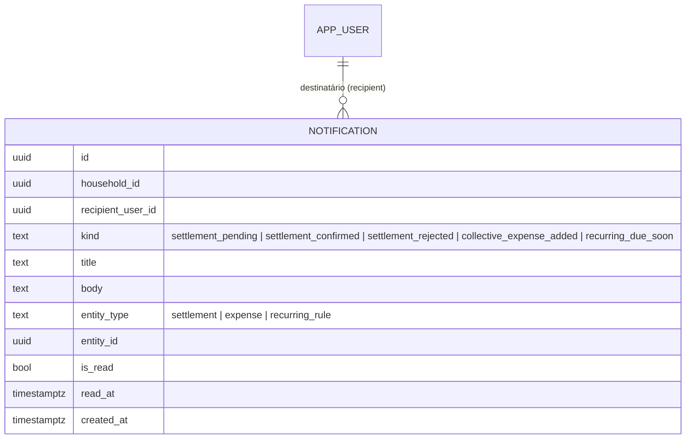

# Plano da Etapa 6: Notificações Internas e Alertas da PWA

> [!IMPORTANT]
> Seguindo as regras do projeto, este documento apresenta os requisitos, regras de negócio, modelo de dados, impactos arquiteturais, riscos de segurança, critérios de aceite e decisões em aberto da **Etapa 6** para sua validação antes da implementação.

## 1. Requisitos cobertos na Etapa 6

- **RF10 (Notificações e alertas para os membros)**:
  - Caixa de entrada de notificações internas por familiar (`user_id`), com contador de não lidas e marcação de leitura individual ou em lote;
  - Eventos que disparam notificações:
    1. **Reembolso registrado pelo devedor aguardando sua confirmação** (`settlement_pending`);
    2. **Reembolso confirmado ou recusado pelo credor** (`settlement_confirmed` / `settlement_rejected`);
    3. **Despesa coletiva lançada ou compartilhada com a casa** em que você é participante da divisão (`collective_expense_added`);
    4. **Alerta de vencimento próximo** de assinatura ou conta recorrente (`recurring_due_soon`);
  - **RNF01 / RNF02 (Privacidade e LGPD)**:
    - Eventos ocorridos no ambiente **individual** de um membro **nunca** geram notificação para outros membros (apenas alertas de vencimento para o próprio dono);
    - Se a PWA usar a API de notificações do navegador (`Notification` / Service Worker), o texto exibido na tela de bloqueio do sistema operacional **não deve expor valores monetários nem descrições privadas** (ex.: exibe apenas *"Você tem uma nova atualização no Finanças Família"*).

---

## 2. Modelo de dados proposto (`00006_notifications.sql`)

### RLS no PostgreSQL (`FORCE ROW LEVEL SECURITY`)
- `notification`:
  - `SELECT` e `UPDATE`: somente o próprio destinatário (`household_id = app_current_household_id() AND recipient_user_id = app_current_user_id()`). Nenhum membro pode ler ou alterar as notificações da caixa de entrada de outro familiar!
  - `INSERT`: qualquer membro ativo da mesma residência (`household_id = app_current_household_id()`) pode inserir uma notificação destinada a outro membro da mesma casa dentro da transação em que criou uma despesa coletiva ou um reembolso.

---

## 3. Rotas REST da Etapa 6

- `GET /api/v1/notifications?unread_only=true` (retorna a lista de notificações do usuário logado e `unread_count`)
- `POST /api/v1/notifications/{id}/read` (marca uma notificação como lida)
- `POST /api/v1/notifications/read-all` (marca todas as notificações do usuário como lidas)

---

## 4. Riscos de segurança e mitigação

| Risco | Mitigação |
|---|---|
| Membro A ler notificações de Membro B (vazando alertas de recorrências individuais de B) | Política RLS `SELECT` estrita (`recipient_user_id = app_current_user_id()`) + retorno 404 |
| Exposição de valores financeiros em banner do sistema operacional | Banners da Notification API do navegador usam texto genérico sem valores; os detalhes ficam apenas dentro da sessão autenticada da aplicação |
| Spam de alertas de vencimento da mesma recorrência | Chave de deduplicação por `(recipient_user_id, kind, entity_id, period_key)` |

---

## 5. Critérios de aceite da Etapa 6

1. Quando Membro A registra um reembolso pendente para Membro B, Membro B recebe automaticamente uma notificação `settlement_pending`; quando B confirma, A recebe `settlement_confirmed`.
2. Quando um membro lança ou compartilha uma despesa no ambiente coletivo, os demais participantes da divisão recebem `collective_expense_added`. Despesas no ambiente individual **nunca** notificam outros membros.
3. Membro A não consegue ler nem marcar como lida uma notificação de Membro B (404 via API e 0 linhas via RLS direto no banco).
4. Frontend PWA exibe o sino/contador de notificações não lidas no topo e permite abrir o painel de notificações e marcá-las como lidas.

---

## 6. Decisões da Etapa 6 para sua validação ❓

| # | Decisão | Opções |
|---|---|---|
| **E6-D1** | **Canal das notificações na PWA** | **(a) Recomendado:** Caixa de entrada interna na barra superior da aplicação (com badge de não lidas e atualização automática) + suporte opcional a alerta local do navegador (`Notification.requestPermission`) com texto genérico sem valores sensíveis, sem depender de servidor Web Push externo. **(b)** Apenas a caixa de entrada interna na interface da aplicação. |
| **E6-D2** | **Antecedência do alerta de vencimento de contas recorrentes / assinaturas** | **(a) Recomendado:** gerar alerta de vencimento próximo quando faltar até **3 dias** para `next_due_date` (uma única vez por ciclo). **(b)** Apenas no próprio dia do vencimento. |
