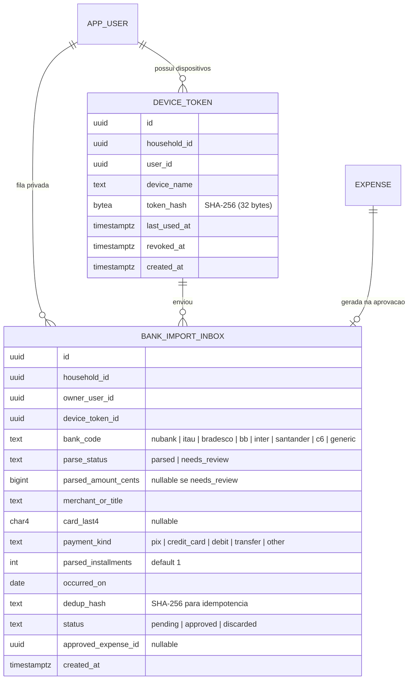

# Plano da Etapa 8: App Android de Captura de Notificações Bancárias e Fila de Importação

> [!IMPORTANT]
> Seguindo as regras do projeto (`AGENTS.md`), este documento apresenta os requisitos, regras de negócio, modelo de dados, impactos arquiteturais, riscos de segurança, critérios de aceite e as **decisões em aberto obrigatórias** (bancos suportados, versão/dispositivos Android e tratamento de notificações com formato incompleto ou alterado) para sua validação antes de qualquer implementação.

## 1. Requisitos cobertos na Etapa 8

- **RF13 (Pareamento e autenticação de dispositivo Android)**:
  - Geração de **Token de Dispositivo** dedicado e revogável individualmente por familiar (`device_token`, conforme Decisão D2 / [ADR 0003](adr/0003-autenticacao-propria-e-sessoes.md)), separado do cookie de sessão da PWA;
  - No banco fica apenas o **SHA-256** do token; qualquer dispositivo pode ser revogado imediatamente pela PWA.
- **RF14 (Captura de notificações bancárias no Android via `NotificationListenerService`)**:
  - App Android nativo em **Kotlin** (`android/`) que escuta apenas os pacotes (`packageName`) dos aplicativos bancários autorizados pelo usuário;
  - Extração local e envio seguro via HTTPS (`Authorization: Bearer <device_token>`) com chave de idempotência (`external_dedup_hash`) para evitar duplicação caso o Android reexiba a mesma notificação.
- **RF15 (Fila de revisão e aprovação antes ou ao virar despesa)**:
  - Nenhuma notificação bancária capturada altera o saldo coletivo da família às cegas: ela entra para o **próprio usuário dono do celular** revisar/aprovar (escolhendo se vai para o seu **Meu Espaço Individual Privado** ou para o **Espaço da Família Coletivo**, categoria e eventual parcelamento).
- **RNF01 / RNF02 (Privacidade estrita e LGPD)**:
  - **Proibido registrar conteúdo de notificações bancárias ou valores em logs** (tanto no Android Logcat de release quanto nos logs do backend Go);
  - **Proibido armazenar credenciais bancárias, CVV ou números completos de cartão (PAN)** (qualquer sequência de 12+ dígitos no texto da notificação é mascarada antes de persistir).

---

## 2. Regras de negócio propostas para a Etapa 8

1. **Isolamento total por dono do dispositivo (`owner_user_id`)**:
   - Cada token de dispositivo e cada item na fila de importação (`bank_notification_inbox`) pertence exclusivamente ao familiar dono daquele celular (`owner_user_id = app_current_user_id()`).
   - Nenhum outro membro da casa consegue ver, aprovar ou descartar as notificações bancárias capturadas no celular de outro familiar (`404` via API + `FORCE ROW LEVEL SECURITY` no PostgreSQL).
2. **Parser versionado por banco e tratamento de formato alterado/incompleto**:
   - Conforme a regra do projeto (*"Não invente respostas para decisões em aberto: bancos suportados, dispositivos Android, notificações com formato alterado"*), apresento as opções em **E8-D1**, **E8-D2** e **E8-D3** abaixo.
3. **Mascaramento preventivo anti-PAN**:
   - Antes de gravar qualquer campo de texto extraído da notificação, o backend aplica mascaramento automático em sequências de 12 a 19 dígitos e nunca grava o texto bruto nos logs da aplicação (`slog`).
4. **Aprovação para Despesa (`POST /api/v1/imports/{id}/approve`)**:
   - Ao aprovar um item da fila, o usuário confirma (ou ajusta) `workspace_id` (padrão: seu ambiente **individual privado**, para nunca expor uma compra pessoal à casa por acidente!), `category_id`, `amount_cents`, `description`, `incurred_on` e `total_installments`, criando a `expense` na mesma transação e marcando o item como `approved`.

---

## 3. Modelo de dados proposto (`00007_android_imports.sql`)



### RLS no PostgreSQL (`FORCE ROW LEVEL SECURITY`)
- `device_token`: `household_id = app_current_household_id() AND user_id = app_current_user_id()`.
- `bank_import_inbox`: `household_id = app_current_household_id() AND owner_user_id = app_current_user_id()`.

---

## 4. Rotas REST propostas para a Etapa 8

- **Gestão de dispositivos (autenticado na PWA via sessão)**:
  - `GET /api/v1/devices` (lista dispositivos do usuário logado)
  - `POST /api/v1/devices` (cria token de dispositivo e retorna o token em texto **uma única vez**)
  - `DELETE /api/v1/devices/{id}` (revoga o token do dispositivo imediatamente)
- **Ingestão pelo App Android (autenticado via `Authorization: Bearer <device_token>`)**:
  - `POST /api/v1/ingest/bank-notification` (recebe o payload da notificação bancária, aplica o parser versionado + mascaramento anti-PAN e grava de forma idempotente em `bank_import_inbox`)
- **Fila de revisão e importação (autenticado na PWA ou no App)**:
  - `GET /api/v1/imports?status=pending`
  - `POST /api/v1/imports/{id}/approve` (transforma em despesa no ambiente individual ou coletivo)
  - `POST /api/v1/imports/{id}/discard` (descarta notificação irrelevante)

---

## 5. Estrutura do App Android (`android/`)

```
android/
├── settings.gradle.kts
├── build.gradle.kts
└── app/
    ├── build.gradle.kts
    └── src/main/
        ├── AndroidManifest.xml          # permissão BIND_NOTIFICATION_LISTENER_SERVICE + INTERNET
        └── java/com/familia/financas/
            ├── BankNotificationService.kt  # NotificationListenerService + filtro de pacotes + fila offline
            ├── BankParser.kt               # parser local versionado + hash SHA-256 de deduplicação
            ├── ApiClient.kt                # envio HTTPS com Bearer device_token (sem logar payload)
            └── MainActivity.kt             # tela de configuração da URL da API, token e botão de permissão
```

---

## 6. Decisões em aberto da Etapa 8 para sua validação ❓

> Como exigido pelas regras do projeto, não inventei respostas para os 3 pontos abaixo. Escolha como prefere seguir em cada um:

### **E8-D1 — Quais bancos brasileiros devem ser suportados nos parsers iniciais?**
- **(a) Recomendado:** Suportar os principais bancos digitais e tradicionais usados no Brasil (**Nubank, Itaú, Bradesco, Banco do Brasil, Inter, Santander e C6 Bank**) com expressões regulares dedicadas para compra no crédito/débito/PIX em BRL (`R$ 123,45`), **mais** um parser genérico em português para qualquer outro app bancário que você marque na lista.
- **(b) Lista específica da sua família:** informe quais bancos os 4 familiares usam (e, se quiser, exemplos anonimizados de texto de notificação).

### **E8-D2 — Versões do Android suportadas nos celulares da família**
- **(a) Recomendado:** `minSdk = 26` (**Android 8.0 Oreo** ou superior) e `targetSdk = 35` (**Android 15**), que cobre >99% dos aparelhos Android em uso hoje e suporta `NotificationListenerService` moderno e criptografia TLS 1.3 nativa.
- **(b) Outra versão mínima:** informe se algum familiar usa Android 7 ou anterior.

### **E8-D3 — Comportamento quando o banco altera o formato da notificação ou o valor não pode ser extraído com 100% de certeza**
- **(a) Recomendado (Sem "chute" + Fila de Revisão Manual):** O parser nunca "chuta" valor nem cria despesa automática quando o formato da notificação é desconhecido ou incompleto. Nesses casos, o item é salvo na fila privada do usuário com `parse_status = 'needs_review'` (guardando o título/estabelecimento mascarado sem PAN e `parsed_amount_cents = null`), para que o usuário preencha o valor exato na revisão ou descarte com 1 clique.
- **(b) Descartar silenciosamente:** se o formato não bater 100% com o parser do banco, ignorar a notificação e não enviar para a fila de revisão.
